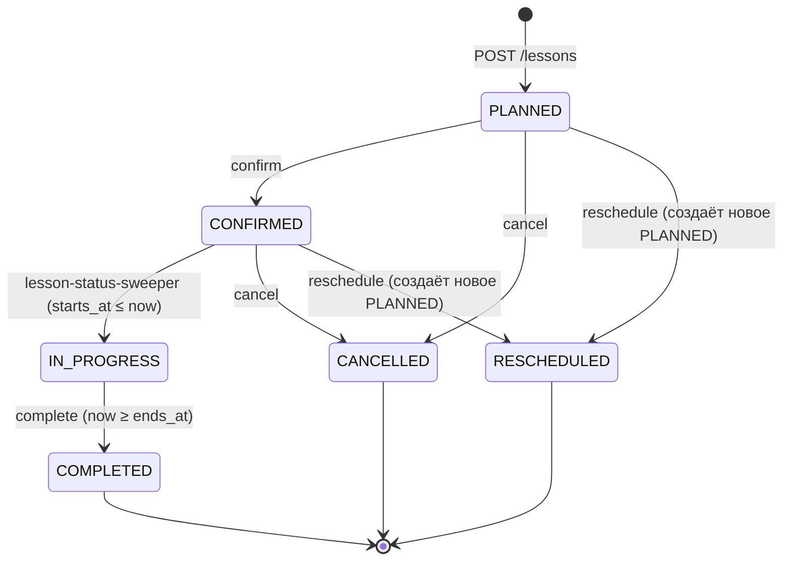
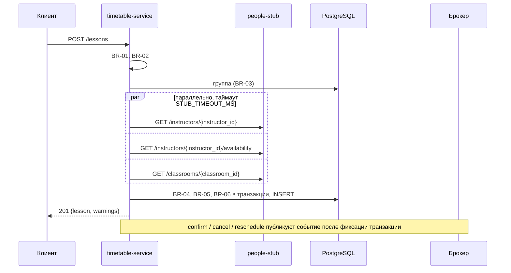

# Расписание и конфликты: тестовое задание для стажёра Backend Python

## 0. Коротко

- **Что сделать.** Микросервис `timetable-service`: расписание занятий с детектором конфликтов, жизненным циклом занятия, вызовами заглушки `people-stub` по HTTP и публикацией событий в брокер.
- **Бюджет.** 8 часов чистого времени на Must при работе с AI-ассистентом; до 2 часов на Should/Could. Срок — 8 календарных дней.
- **Как сдать.** git bundle → свой удалённый репозиторий → тег `submission` → ссылка HR (раздел 6).
- **Что оценивается.** Критерии K1–K7 (раздел 7). Единственный блокирующий критерий — `docker compose up --build` и `GET /health/ready` → 200.
- **Вопросы** — HR (раздел 9).

## 1. Кому адресовано и что мы оцениваем

Задание адресовано кандидатам в стажёры backend Python в заказной разработке: студентам старших курсов и выпускникам без коммерческого опыта, от которых ожидается самостоятельность — читать контракт, принимать и фиксировать решения при неполных требованиях.

Оцениваются семь компетенций K1–K7: предметная логика, контракт API и данные, асинхронность, инфраструктура, тесты, качество кода, процесс и коммуникация.

Не оцениваются: UI, производительность под нагрузкой, знание предметной области, выбор между FastAPI и Sanic, RabbitMQ и Kafka.

## 2. Контекст (легенда)

Учебный центр «WA» ведёт программы дополнительного профессионального образования: набирает слушателей в группы и проводит очные и онлайн-занятия. Расписание составляет администратор или методист; занятие ведёт преподаватель, посещают слушатели группы. Платформа состоит из микросервисов. Преподавателей (дневная норма часов, часовой пояс, окна доступности) и аудитории (вместимость) хранит соседний сервис — он выдан готовой заглушкой `people-stub` с контрактом `stub-openapi.yaml`; сервис расписания запрашивает их при проверке занятия. Другие сервисы узнают об изменениях расписания из событий.

## 3. Задача (Must)

### 3.1 Сценарии

1. **Постановка занятия.** Методист создаёт занятие для группы с преподавателем, форматом и интервалом; сервис проверяет правила и создаёт занятие в `PLANNED` (возможно, с предупреждениями) или отклоняет запрос с деталями.
2. **Предварительная проверка.** `POST /lessons/validate` возвращает те же нарушения и предупреждения, ничего не создавая.
3. **Жизненный цикл.** Занятие подтверждают (`confirm`), с наступлением времени начала фоновая задача переводит его в `IN_PROGRESS`, после окончания его завершают (`complete`). Подтверждение и отмена публикуют события.
4. **Перенос.** Занятие в статусе `PLANNED` или `CONFIRMED` переносят на другой интервал: исходное переходит в `RESCHEDULED`, создаётся ровно одно новое занятие со ссылкой `rescheduled_from_id`; публикуется событие.
5. **Просмотр.** Расписание выбирается с фильтрами по группе, преподавателю, аудитории, статусу и периоду.

### 3.2 Предметные правила и инварианты

**Активные занятия** — в статусах `PLANNED`, `CONFIRMED`, `IN_PROGRESS`, `COMPLETED`. Занятия в статусах `CANCELLED` и `RESCHEDULED` в проверках BR-05 и BR-06 не учитываются.

Правила BR-01…BR-07 одинаково проверяются при создании, валидации, изменении и переносе; изменяемое (переносимое) занятие само с собой не конфликтует. При нескольких нарушениях ответ определяется первым по таблице; проверка статуса занятия выполняется раньше правил.

| ID | Правило | Тип | Нарушение |
| --- | --- | --- | --- |
| BR-01 | `ends_at` строго позже `starts_at`; длительность от 30 минут до 8 часов включительно | hard | 422 `VALIDATION_ERROR`, `details.fields` |
| BR-02 | Формат `IN_PERSON` требует `classroom_id`; формат `ONLINE` проходит без аудитории, `classroom_id` для него должен быть `null` | hard | 422 `CLASSROOM_REQUIRED` (IN_PERSON без аудитории); 422 `VALIDATION_ERROR` (ONLINE с аудиторией) |
| BR-03 | Группа существует в сервисе; преподаватель и аудитория существуют в `people-stub` | hard | 422 `GROUP_NOT_FOUND`, `INSTRUCTOR_NOT_FOUND`, `CLASSROOM_NOT_FOUND` |
| BR-04 | Для `IN_PERSON` вместимость аудитории (из заглушки) не меньше размера группы | hard | 409 `CLASSROOM_TOO_SMALL`, `details`: `capacity`, `group_size` |
| BR-05 | Занятие не пересекается по времени с другим активным занятием того же преподавателя, той же аудитории или той же группы | hard | 409 `SCHEDULE_CONFLICT`, `details.conflicts[]`: все найденные конфликты — `resource` (`instructor`/`classroom`/`group`), `lesson_id`, `overlap` (`starts_at`, `ends_at` пересечения) |
| BR-06 | Суммарная длительность активных занятий преподавателя за день с учётом нового превышает `max_hours_per_day` (из заглушки) | soft | 201/200, предупреждение `WORKLOAD_SOFT_LIMIT` с `max_hours`, `planned_hours`, `date` |
| BR-07 | Занятие целиком не попадает ни в одно окно доступности преподавателя (из заглушки) | soft | 201/200, предупреждение `INSTRUCTOR_UNAVAILABLE` |
| BR-08 | `complete` допустим только при `now ≥ ends_at` по часам сервиса | hard | 409 `LESSON_NOT_FINISHED`, `details`: `ends_at`, `now` |

Предупреждения (soft) не блокируют операцию и возвращаются в `warnings[]`: `{"code", "message", "details"}`.

Время на входе — ISO 8601 со смещением (без смещения → 422 `VALIDATION_ERROR`), на выходе — UTC с `Z`. Занятие можно создать и перенести на любую дату, включая прошедшую.

**Жизненный цикл занятия.** Недопустимый переход отклоняется: 409 `TRANSITION_FORBIDDEN`, `details`: `current_status`, `target_status`. Изменение через `PATCH` разрешено только в статусе `PLANNED`, иначе 409 `LESSON_NOT_EDITABLE`. Переход в `IN_PROGRESS` выполняет только фоновая задача `lesson-status-sweeper` (FR-10): она переводит `CONFIRMED`-занятия, у которых `starts_at ≤ now`, в `IN_PROGRESS` (в том числе если `ends_at` уже наступил); занятия в других статусах задача не изменяет.



**Перенос** атомарен: перевод исходного занятия в `RESCHEDULED` и создание нового (статус `PLANNED`, та же группа, `rescheduled_from_id` = исходное) происходят вместе или не происходят вовсе. Новое занятие проходит все правила BR-01…BR-07. У одного занятия может быть не более одного переноса, в том числе при одновременных запросах.

### 3.3 Контракт API

Нормативный контракт — `openapi.yaml` (схемы, коды ответов, перечень кодов ошибок). Ошибки — `{"error": {"code", "message", "details"}}`; невалидный JSON или неверный тип поля — 400 `BAD_REQUEST`; ресурс из пути не найден — 404 `NOT_FOUND`; ссылка в теле на несуществующую сущность — 422 `<ENTITY>_NOT_FOUND`.

| Метод | Путь | Назначение | FR |
| --- | --- | --- | --- |
| POST | `/lessons` | Создать занятие; 201 `{lesson, warnings}` | FR-01 |
| POST | `/lessons/validate` | Проверить без создания; 200 `{ok, violations, warnings}` | FR-02 |
| GET | `/lessons` | Список с фильтрами `group_id`, `instructor_id`, `classroom_id`, `status`, `from`, `to` и пагинацией | FR-03 |
| GET | `/lessons/{lesson_id}` | Занятие по идентификатору | FR-04 |
| PATCH | `/lessons/{lesson_id}` | Изменить интервал, формат, преподавателя, аудиторию (только `PLANNED`); 200 `{lesson, warnings}` | FR-05 |
| POST | `/lessons/{lesson_id}/confirm` | `PLANNED → CONFIRMED`, событие `LessonConfirmed` | FR-06 |
| POST | `/lessons/{lesson_id}/cancel` | `→ CANCELLED`, необязательная причина, событие `LessonCancelled` | FR-07 |
| POST | `/lessons/{lesson_id}/reschedule` | Перенос; 201 `{lesson, warnings}` с новым занятием, событие `LessonRescheduled` | FR-08 |
| POST | `/lessons/{lesson_id}/complete` | `IN_PROGRESS → COMPLETED` | FR-09 |
| — | фоновая задача `lesson-status-sweeper` | `CONFIRMED → IN_PROGRESS` | FR-10 |
| GET | `/groups/{group_id}` | Группа (`id`, `name`, `size`) | FR-11 |

`POST /lessons/validate` возвращает в `violations[]` нарушения, которые в `POST /lessons` дают 409; ошибки 422, 502, 504 возвращаются теми же кодами. Фильтр `GET /lessons` по периоду: `from ≤ starts_at < to`; сортировка по `starts_at`, затем `id`; `limit` ≤ 200.

### 3.4 Интеграционный контур

**Заглушка `people-stub` (FR-12)** (`STUB_BASE_URL`) вызывается только при создании, валидации, изменении и переносе. Используются три эндпоинта: профиль преподавателя (`max_hours_per_day`, `timezone`), недельные окна доступности преподавателя, аудитория (`capacity`; только для `IN_PERSON`). Каждый вызов ограничен таймаутом `STUB_TIMEOUT_MS` (по умолчанию 2000). Ответ 404 заглушки означает отсутствие сущности (BR-03). При отказе заглушки (ответ 5xx или превышение таймаута) операция, для которой ответ необходим, отклоняется в формате платформы: 502 `UPSTREAM_UNAVAILABLE` или 504 `UPSTREAM_TIMEOUT` соответственно; занятие при этом не создаётся и не изменяется.

**Async-кейс (обязателен).** Три вызова заглушки для одного занятия независимы и выполняются **параллельно**. При `STUB_LATENCY_MS=300` последовательное выполнение занимает около 900 мс, параллельное — около 300 мс. Выигрыш подтверждается тестом с фейковым клиентом и искусственными задержками (без сети и заглушки) и описывается в разделе README «Async-кейс» с командой воспроизведения. Скрытый e2e проверяет параллелизм по счётчику одновременных запросов заглушки (`GET /__stub/stats`, поле `max_in_flight`).



**События (FR-13).** Сервис публикует в брокер (RabbitMQ: exchange `wa.events`, routing key `timetable.<EventType>`; Kafka: топик `wa.timetable.events`, ключ — `lesson_id` исходного занятия) три события по контракту `asyncapi.yaml`: `LessonConfirmed`, `LessonCancelled`, `LessonRescheduled`. Конверт общий для платформы: `event_id`, `event_type`, `occurred_at` (по часам сервиса), `idempotency_key` = `<event-type-kebab>:<lesson_id>` (`lesson-confirmed:<lesson_id>`, `lesson-cancelled:<lesson_id>`, `lesson-rescheduled:<lesson_id>`), `producer` = `timetable-service`, `version` = 1, `payload`. Событие публикуется только при успешно выполненной операции; отклонённая операция события не порождает. Брокер выбирается один; переменная `BROKER` определяет, какой используется. Для Must достаточно публикации сразу после commit транзакции (at-least-once, без transactional outbox); outbox с фоновой отправкой — превышение уровня, не требуется.

### 3.5 Данные

Seed и фикстуры заглушки даны в scaffold (`seed/`, `stubs/people-stub/fixtures.json`) и выполняются `just seed` или при `SEED_ON_START=1`. Полная таблица идентификаторов — в Приложении B; ключевые: группа G1 `9a000000-0000-4000-8000-000000000001` (12 слушателей), преподаватель I1 `1b000000-0000-4000-8000-000000000001`, аудитория C1 `2c000000-0000-4000-8000-000000000001`. Окна доступности заданы в местном времени преподавателя; его часовой пояс (IANA) указан в профиле. E2e-тесты начинают с `PUT /__test/time` (`2026-11-30T03:00:00Z`) и `POST /__test/reset`.

### 3.6 Требования к тестируемости

- Порты: `app` 8000, заглушка 8100, PostgreSQL 5432, RabbitMQ 5672, Kafka 9092. Переменные: `DATABASE_URL`, `BROKER`, `BROKER_URL`, `STUB_BASE_URL`, `STUB_TIMEOUT_MS`, `TEST_MODE`, `SEED_ON_START`, `JOBS_INTERVAL_SECONDS`, `LOG_LEVEL`; `.env.example` соответствует коду.
- `GET /health/live` — 200, пока процесс жив. `GET /health/ready` — 200 `{"status":"ok","db":"ok","broker":"ok"}`, если доступны БД и брокер; иначе 503 со `"status":"degraded"` и статусом каждой зависимости. Заглушка в readiness не входит.
- «Сейчас» везде берётся из единой абстракции `Clock`. При `TEST_MODE=1` доступны `GET/PUT/DELETE /__test/time` (установленное время зафиксировано, `DELETE` возвращает системные часы), `POST /__test/jobs/lesson-status-sweeper/run` → `{"processed": <int>}`, `POST /__test/reset` (данные и seed, часы не меняет); периодический запуск задачи отключён. При `TEST_MODE=0` тестовые эндпоинты отвечают 404, задача запускается с интервалом `JOBS_INTERVAL_SECONDS` (по умолчанию 30, не более 60). Неизвестное имя задачи — 404 `NOT_FOUND`.
- Заглушка имеет служебные эндпоинты `GET/PUT/DELETE /__stub/config` (режимы задержки и отказов на лету) и `GET/DELETE /__stub/stats` (счётчики вызовов, `max_in_flight`); их использует e2e, сервису они не нужны.
- Ответы детерминированы при одинаковых часах и seed.

### 3.7 Вне объёма

Аутентификация и авторизация (ролевая модель в задании не используется, заголовок `X-Role` не требуется); пользовательский интерфейс; производительность под нагрузкой; безопасность сверх базовой валидации; мультитенантность; файлы и хранилище объектов; посещаемость, журнал, учебный план; автоматическое составление (оптимизация) расписания; хранение преподавателей и аудиторий в сервисе.

## 4. Дополнительно (Should / Could)

Не влияют на минимальную приёмку; суммарно до 2 часов.

| ID | Приоритет | Задача | Оценка |
| --- | --- | --- | --- |
| FR-14 | Should | `POST /lesson-series`: серия из `count` занятий по `weekdays`; правила для каждого; всё или ничего; конкурентная валидация с ограничением параллелизма | 1,0 ч |
| FR-15 | Should | `GET /instructors/{instructor_id}/workload?week=YYYY-Www`: часы по дням и признак превышения нормы | 0,5 ч |
| FR-16 | Could | `GET /groups` со стандартной пагинацией | 0,1 ч |
| FR-17 | Could | Кэш ответов заглушки с TTL; инвалидация и TTL описаны в README | 0,4 ч |

## 5. Технические требования

- **Стек:** Python 3.12; FastAPI или Sanic; uv (альтернатива — poetry); SQLAlchemy 2.0 async и Alembic; PostgreSQL 16; pytest; mypy strict с конфигурацией scaffold (не ослаблять); ruff; Docker и docker compose; OpenSpec; RabbitMQ или Kafka на выбор. Другие компоненты не используются.
- **Docker обязателен:** решение, не стартующее `docker compose up --build` с проходящим `GET /health/ready`, к проверке не принимается.
- **Async обоснован:** параллельные вызовы заглушки (3.4) с тестом выигрыша; без блокирующих вызовов в event loop.
- **mypy и ruff** чисты без необъяснённых подавлений; `alembic upgrade head` на чистой БД проходит.
- **OpenSpec:** `proposal`, `specs`, `design`, `tasks` в `openspec/` коммитятся вместе с кодом и отражают реальные изменения.

## 6. Как работать и как сдать

1. Получить от HR git bundle, выполнить `git clone timetable-service.bundle` (ветка `master`, базовый коммит — тег `scaffold-base`). Окружение: Docker Compose v2.20+ и buildx 0.17+, uv 0.13+, just; проверка — `just doctor`, установка — `SCAFFOLD.md` в репозитории.
2. Работать в собственном удалённом репозитории с доступом по ссылке: пакетами работ, по ветке на пакет, с коммитами по Conventional Commits (§6.1, `CONTRIBUTING.md`; `just setup` после клонирования). История коммитов входит в K7.
3. Заполнить README по шаблону (Приложение A); заголовки проверяются автоматически.
4. Поставить тег `submission` на последнем коммите `master`, запушить ветки и теги (`git push --all && git push --tags`), отправить HR ссылку и имя тега. Срок — 8 календарных дней.
5. Далее — автоматическая проверка, проверка человеком, при прохождении порога — дебриф 45 минут. Обратная связь — всем сдавшим в течение 48 часов после проверки.

### 6.1 Пакеты работ, ветки и слияние

Работа ведётся пакетами WP-NN (Приложение C): пакет — одна ветка `change/wpNN-<slug>` и один OpenSpec change с тем же идентификатором; в `master` пакет попадает merge-коммитом (`just merge-change`), сообщения — по Conventional Commits. Соглашения, формат merge-коммита и перечень автоматических проверок — в `CONTRIBUTING.md` в корне репозитория. Результат проверки истории учитывается в критерии K7 и gate не блокирует.

### 6.2 Оценки времени и журнал

Оценки в Приложении C ориентировочны: получены замером на сотруднике с коэффициентом и носят субъективный характер; они задают объём, а не норматив скорости. Скорость выполнения не оценивается, отклонение факта от оценки на оценку работы не влияет. Назначение оценок — самопроверка: до начала пакета фиксируется собственная оценка; расхождение с оценкой задания в 2 раза и более — повод перечитать FR пакета и либо задать вопрос (§9), либо записать принятую трактовку в README «Решения». Фактическое чистое время фиксируется по пакетам в README «Время» (формат — Приложение A); при превышении оценки в 2 раза и более и не менее чем на 1 ч указывается, куда ушло время. Журнал используется для калибровки задания и дебрифа; его правдоподобие сверяется с историей коммитов в грубом приближении.

## 7. Как мы оцениваем

Конвейер: **gate** (автоматически, блокирующий) → **e2e** чёрного ящика по `openapi.yaml` → **LLM-судья** (совещательно) → **человек** (подтверждает или правит оценку) → **дебриф** (walkthrough 10 мин, разбор 2–3 решений и async-кейса 15 мин, живое расширение требования 15 мин, вопросы кандидата 5 мин).

Gate: клон по тегу `submission`, `docker compose up --build` за 5 минут, `GET /health/ready` → 200, `alembic upgrade head` на чистой БД, шесть заголовков README. При провале — лог кандидату и одна повторная сдача в срок. Автоматически проверяются e2e (Must-сценарии, запрещённые переходы, управляемое время, события, отказы заглушки), mypy, ruff, тесты и история коммитов по `CONTRIBUTING.md` (не блокирует, учитывается в K7).

| Критерий | Вес | Измеритель | Уровень 4 выглядит так |
| --- | --- | --- | --- |
| K1 Корректность предметной логики | 25% | e2e + судья | Все Must-сценарии проходят, запрещённые действия отклоняются с понятной ошибкой, пробелы замечены и закрыты обоснованным решением |
| K2 Контракт API и данные | 10% | e2e + судья | Контракт соблюдён без отклонений, схема нормализована под задачу, ограничения в БД, миграции воспроизводимы |
| K3 Асинхронность | 10% | судья + дебриф | Async применён там, где даёт выигрыш, выигрыш показан замером или тестом; нет блокирующих вызовов в event loop |
| K4 Инфраструктура и запуск | 15% | gate + судья | `docker compose up` поднимает всё с healthcheck, конфигурация через окружение, брокер используется по назначению, отказы интеграции обработаны |
| K5 Тесты | 15% | судья | Предметная логика протестирована отдельно от HTTP, покрыты краевые случаи, тесты читаются как спецификация, CI зелёный |
| K6 Качество кода и типизация | 15% | mypy, ruff + судья | mypy и ruff чисты в конфигурации scaffold, слои разделены, имена соответствуют поведению, коллега расширит без переписывания |
| K7 Процесс и коммуникация | 10% | судья + дебриф | OpenSpec-артефакты отражают реальные изменения, README называет trade-off и несделанное, AI notes конкретны, история коммитов осмысленна |

Уровни: 1 — не соответствует, 2 — частично, 3 — соответствует, 4 — превосходит. Порог приглашения на дебриф: gate пройден; Must-сценарии e2e зелёные (допустим один красный с объяснением в README); взвешенный балл ≥ 2,5, подтверждённый человеком. Решение — после дебрифа, не по баллу.

## 8. Политика AI

AI-инструменты разрешены и ожидаются: ChatGPT, Claude, Gemini, GitHub Copilot Free, Cursor Free, Codeium/Windsurf, локальные модели, включая бесплатные уровни. В README «AI notes» — инструменты, где применялись, что пришлось исправлять, что отвергнуто и почему. Нарушением считается сдача чужого готового решения и подмена авторства; использование AI нарушением не является.

Решение проверяется автоматизированными средствами, включая LLM-сервисы, после анонимизации. Права на код остаются у кандидата.

## 9. Вопросы и обратная связь

Вопросы по постановке направляются HR и передаются составителям задания; ответ — в течение одного рабочего дня. Ответ даётся по существу условия, без подсказок по архитектуре и коду; на вопросы о ситуациях, которые условие не регулирует, — «решение остаётся за вами, зафиксируйте его в README»; организационные вопросы решаются по регламенту. Уточнение, данное одному кандидату, сообщается всем. HR выдаёт bundle, принимает сдачу, напоминает о сроке и передаёт обратную связь (в течение 48 часов после проверки).

---

## Приложение A. Шаблон README

```markdown
# timetable-service
## Запуск
## Решения
## Не сделано
## Async-кейс
## AI notes
## Время
```

- **Запуск** — команды запуска, выбранный брокер, проверка готовности.
- **Решения** — принятые решения с альтернативами и причинами, включая решения по ситуациям, которые задание не регулирует.
- **Не сделано** — что не сделано и почему.
- **Async-кейс** — что выполняется параллельно, как воспроизвести замер, полученные цифры.
- **AI notes** — инструменты, где применялись, что пришлось исправлять, что отвергнуто.
- **Время** — таблица по пакетам Приложения C с фиксированными столбцами (§6.2):

```markdown
## Время
| Пакет | Оценка задания, ч | Моя оценка до старта, ч | Факт, ч | Куда ушло время (при факте ≥ 2× и ≥ +1 ч) |
| --- | --- | --- | --- | --- |
| wp01-… | | | | |
| Итого | 7,45 | | | |
```

## Приложение B. Публичные e2e-тесты и примеры запросов

**Данные seed и фикстур заглушки.**

| Сущность | ID | Данные |
| --- | --- | --- |
| Группа G1 | `9a000000-0000-4000-8000-000000000001` | «ПРГ-24-1», 12 слушателей |
| Группа G2 | `9a000000-0000-4000-8000-000000000002` | «ВЕБ-24-2», 25 слушателей |
| Группа G3 | `9a000000-0000-4000-8000-000000000003` | «ДАН-24-3», 8 слушателей |
| Преподаватель I1 | `1b000000-0000-4000-8000-000000000001` | 6 ч/день; пн–пт 09:00–18:00, `Asia/Yekaterinburg` (UTC+5) |
| Преподаватель I2 | `1b000000-0000-4000-8000-000000000002` | 4 ч/день; пн–пт 09:00–18:00, `Asia/Yekaterinburg` |
| Преподаватель I3 | `1b000000-0000-4000-8000-000000000003` | 8 ч/день; вт, чт 12:00–20:00, `Europe/Moscow` (UTC+3) |
| Преподаватели I4, I5, I6 | `…000000000004`, `…05`, `…06` (префикс `1b000000-0000-4000-8000-`) | I4 — заглушка отвечает 500; I5 — ответ задерживается на 10 с; I6 — профиль доступен, эндпоинт окон доступности отвечает 500 |
| Аудитории C1, C2, C3 | `2c000000-0000-4000-8000-000000000001`, `…02`, `…03` | вместимость 30, 10, 20 |
| Аудитории C4, C5 | `…04`, `…05` (префикс `2c000000-0000-4000-8000-`) | C4 — 500; C5 — задержка 10 с |

Seed содержит восемь занятий L1–L8 (`3d000000-0000-4000-8000-0000000000NN`) в период 2026-11-27 — 2026-12-03 во всех статусах, кроме `IN_PROGRESS`; их состав — в `seed/README.md` scaffold.

Публичные тесты лежат в `tests/e2e/public/` и запускаются `just e2e-public` против поднятого стека. Скрытый набор устроен так же и содержит больше сценариев. Общие предусловия каждого теста:

```http
PUT /__test/time
{"now": "2026-11-30T03:00:00Z"}

POST /__test/reset
```

**E2E-01. Создание очного занятия без нарушений (FR-01).**

```http
POST /lessons
{"group_id": "9a000000-0000-4000-8000-000000000001",
 "instructor_id": "1b000000-0000-4000-8000-000000000001",
 "classroom_id": "2c000000-0000-4000-8000-000000000001",
 "format": "IN_PERSON",
 "starts_at": "2026-12-02T07:00:00Z", "ends_at": "2026-12-02T08:30:00Z"}
```

Ожидается 201; `lesson.status` = `PLANNED`, `lesson.rescheduled_from_id` = `null`, `warnings` = `[]`; `GET /lessons/{lesson.id}` возвращает то же занятие.

**E2E-02. Конфликт по преподавателю (FR-01, BR-05).** Seed-занятие L1 (`3d000000-0000-4000-8000-000000000001`): группа G1, преподаватель I1, аудитория C1, `2026-12-01T05:00:00Z`–`06:30:00Z`, `PLANNED`.

```http
POST /lessons
{"group_id": "9a000000-0000-4000-8000-000000000003",
 "instructor_id": "1b000000-0000-4000-8000-000000000001",
 "classroom_id": null, "format": "ONLINE",
 "starts_at": "2026-12-01T06:00:00Z", "ends_at": "2026-12-01T07:00:00Z"}
```

Ожидается 409:

```json
{"error": {"code": "SCHEDULE_CONFLICT", "message": "...",
  "details": {"conflicts": [{"resource": "instructor",
    "lesson_id": "3d000000-0000-4000-8000-000000000001",
    "overlap": {"starts_at": "2026-12-01T06:00:00Z", "ends_at": "2026-12-01T06:30:00Z"}}]}}}
```

Занятие не создано: `GET /lessons?instructor_id=1b000000-0000-4000-8000-000000000001&from=2026-12-01T00:00:00Z&to=2026-12-02T00:00:00Z` возвращает `total` = 1 (только L1).

**E2E-17. Подтверждение и событие (FR-06).**

```http
POST /lessons/3d000000-0000-4000-8000-000000000001/confirm
```

Ожидается 200, `status` = `CONFIRMED`. В брокере в течение 5 секунд появляется ровно одно событие `LessonConfirmed` с `producer` = `timetable-service`, `version` = 1, `idempotency_key` = `lesson-confirmed:3d000000-0000-4000-8000-000000000001`, `payload.lesson_id` = L1. Повторный `confirm` → 409 `TRANSITION_FORBIDDEN`, `details` = `{"current_status": "CONFIRMED", "target_status": "CONFIRMED"}`; второе событие не публикуется.

## Приложение C. Пакеты работ и оценка времени

Работа ведётся пакетами (§6.1, `CONTRIBUTING.md`): пакет — одна ветка `change/wpNN-<slug>` и один OpenSpec change с тем же идентификатором. Идентификаторы ниже рекомендуемые: номер пакета сохраняется, `<slug>` можно уточнить. Оценка — чистое время стажёра при работе с AI-ассистентом, включая модульные тесты и OpenSpec-артефакты пакета; оценки ориентировочны (§6.2). Каркас (Docker, compose, CI, `Clock`, `/__test/time`, запуск фоновых задач, единый формат ошибок, health) дан готовым и в оценку не входит.

| Пакет | Рекомендуемый идентификатор | Требования | Содержание | Оценка, ч |
| --- | --- | --- | --- | --- |
| WP-00 | — (без ветки) | — | Процесс: чтение задания, собственные оценки до старта, журнал времени, слияния пакетов | 0,75 |
| WP-01 | `wp01-load-seed-data` | FR-04, FR-11, NFR-02, NFR-03 | Модели и миграция с ограничениями; загрузчик seed (`just seed`, `SEED_ON_START`, `POST /__test/reset`); чтение занятия и группы | 0,8 |
| WP-02 | `wp02-add-people-client` | FR-12, NFR-07 | Клиент `people-stub`: три параллельных вызова, таймаут, 404/5xx/таймаут → коды задания; тест async-кейса | 0,75 |
| WP-03 | `wp03-detect-lesson-conflicts` | FR-01, FR-02 | Правила BR-01…BR-07, предупреждения, порядок проверок; `POST /lessons`, `POST /lessons/validate` | 1,75 |
| WP-04 | `wp04-list-and-edit-lessons` | FR-03, FR-05 | Список с фильтрами, сортировкой и пагинацией; `PATCH` только в `PLANNED` с повторной проверкой правил | 0,8 |
| WP-05 | `wp05-manage-lesson-lifecycle` | FR-06, FR-07, FR-08, FR-09, FR-10 | `confirm`, `cancel`, `complete` (BR-08), атомарный `reschedule`, задача `lesson-status-sweeper` | 1,5 |
| WP-06 | `wp06-publish-lesson-events` | FR-13 | Публикация событий в выбранный брокер, readiness с брокером | 0,7 |
| WP-07 | `wp07-finalize-docs` | NFR-05, NFR-06 | README по шаблону, AI notes, архив OpenSpec, зелёные CI и `just lint-commits` | 0,4 |
| | | | **Итого Must** | **7,45** |
| WP-08 | `wp08-create-lesson-series` | FR-14 | Should: серия занятий | 1,0 |
| WP-09 | `wp09-report-instructor-workload` | FR-15 | Should: нагрузка преподавателя за неделю | 0,5 |
| WP-10 | `wp10-list-groups-cache-people` | FR-16, FR-17 | Could: `GET /groups`; кэш ответов заглушки с TTL | 0,5 |
| | | | **Итого Should/Could** | **2,0** |

Нефункциональные требования: NFR-01 — запуск `docker compose up --build`, health; NFR-02 — миграции Alembic воспроизводимы; NFR-03 — детерминированный seed и управляемое время; NFR-04 — единый формат ошибок; NFR-05 — mypy strict и ruff чисты; NFR-06 — OpenSpec-артефакты и README по шаблону; NFR-07 — async-кейс подтверждён тестом.
